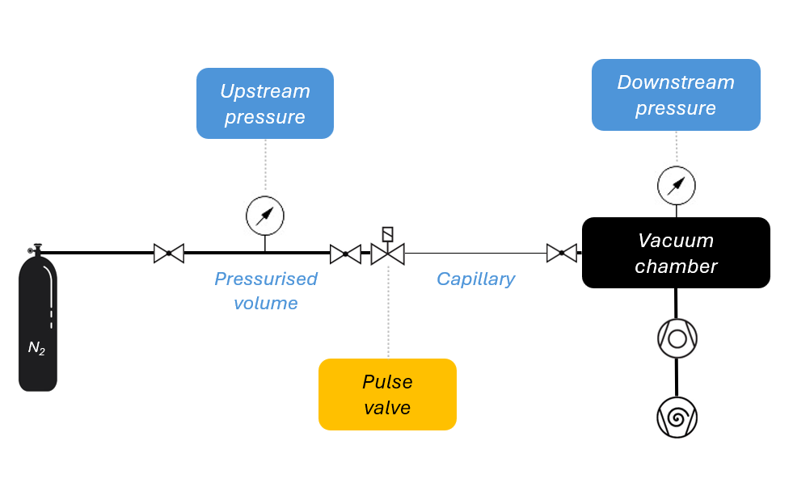

# PULSE-VALVE-DRIVER

Python driver for serial pulse valve systems with real-time pressure and temperature logging, plus high-rate capture of individual pulse transients.

Designed for gas handling characterisation work: fire single calibrated pulses through a pulse valve, log upstream pressure, upstream temperature, and vacuum chamber pressure, and export timestamped CSV data for post-processing. A capture mode streams the chamber gauge at kHz rates through a single shot, which is the only way to measure the peak a pulse actually produces.

Every capture and session row is **self-describing**: the conductance limiter geometry, the gas, and the upstream pressure at the fire instant are stamped into the output, so a file can be analysed and compared later without the lab notebook.

---

## Experiment setup



N₂ supply → isolation valve → **pressurised volume** (upstream pressure sensor) → 
isolation valve → **pulse valve** → conductance limiter → vacuum chamber (downstream pressure sensor + turbopump).

---

## Features

- Single-shot pulse valve control via ZC1 controller over RS-232/USB
- Real-time upstream pressure and temperature logging (Keller PAA series)
- Vacuum chamber pressure logging via LabJack U3 (Pfeiffer IKR 270 behind a voltage divider)
- **Pulse capture**: hardware-streamed chamber pressure through a single shot, with the valve fired automatically inside the capture window
- Automatic analysis of each capture — peak, Δp, rise time, decay constant, effective pumping speed, gas delivered per pulse
- **Paired-pulse test** (`pp`): fires two pulses a set Δt apart, timed by the ZC1, to test whether the upstream capillary acts as a brake or as a reservoir that has to refill
- **Run identity**: limiter bore/length and gas are recorded with every capture and row and can be changed live; upstream pressure and temperature are snapshotted at the fire instant
- Single timestamped CSV per session with per-pulse events embedded inline (microsecond resolution), plus one CSV per capture and a per-session capture manifest summarising every shot in one table
- Auto-detection of serial devices on any COM port, with automatic reconnection if a device disconnects mid-session
- Tkinter GUI: live readouts, three synchronised strip charts (upstream pressure, upstream temperature, vacuum chamber), and a valve driver terminal
- Companion tools for plotting sessions, plotting single captures, re-analysing and plotting paired-pulse tests, and diagnosing the vacuum gauge

---

## Hardware

| Device | Interface | Role |
|---|---|---|
| Keller PAA-23SX-H2 | RS-485 / USB (K-114 adapter) | Upstream pressure + temperature |
| Gyger SMLD 300G | Driven by ZC1 controller | Pulse valve |
| ZC1 controller | RS-232 / USB | Pulse valve driver |
| LabJack U3 | USB | Vacuum chamber gauge on FIO2 |

The LabJack is optional for logging but **required for capture**, which uses the U3's hardware streaming mode.

Only one process may hold the U3 at a time. Close any other program that opens it before running the driver.

---

## Requirements

```
pip install pyserial keller-protocol LabJackPython matplotlib
```

LabJackPython is optional — the driver runs without it if no vacuum gauge is connected, but capture is then unavailable. `matplotlib` is only needed for the plotters, not the driver itself.

---

## Usage

```bash
python PULSE-VALVE-DRIVER.py
```

### Valve driver commands

| Command | Action |
|---|---|
| `v` | Fire one pulse, no capture |
| `c [n]` | Capture n pulses at high rate (default 1, max 50) |
| `pp [dt_ms …]` | Paired-pulse test: is the upstream capillary a brake (A) or a reservoir (B)? With no Δt given, runs `PAIR_DT_MS` |
| `pp stop` | End the paired-pulse test early; the pairs so far are summarised |
| `t <µs>` | Set open time (50 – 5 000 000 µs) |
| `cap <up\|down> <id_µm> <len_mm>` | Record a capillary on the given side (bore in µm, length in mm) |
| `cap up none` | Record that no upstream capillary is fitted |
| `gas <species>` | Record the gas at the valve (e.g. `N2`, `H2`, `He`, `Ar`) |
| `q` | Quit |

The open time in force is shown in the driver window, recorded in every session CSV row, and written into each capture file header — so pulses fired at different open times are always distinguishable. The limiter and gas are shown the same way (see **Run identity** below).

### Run identity

The capillary geometry and the gas cannot be detected by any instrument — they change only when hardware is physically swapped. They are held as live settings, seeded at startup from the configuration block and changeable at any time with `cap` and `gas`. Whatever is in force is stamped into every subsequent capture header and session row.

Two capillaries are recorded independently. The **downstream** one is the conductance limiter after the valve, into the chamber — it sets chamber conductance and shapes the decay, and the Gyger is never run without it, so it is always fitted. The **upstream** one is the feed capillary before the valve, on the reservoir side; it is not always present, and `cap up none` records that.

```
cap down 50 100    # downstream: 50 µm bore, 100 mm (= 10 cm) long. NOTE: length is in mm.
cap down 41.5 100  # non-integer bore is fine (record as-measured, not nominal)
cap up 130 100     # upstream feed capillary
cap up none        # no upstream capillary fitted
gas N2             # gas at the valve
```

Both numbers are required and must be positive; `cap down 50` alone, or a zero/negative value, is rejected. The numbers are parsed as floats. The side may be abbreviated (`u`/`d`). Only the upstream side can be cleared with `none` — the downstream capillary is always present on this rig, so there is no way to record its absence.

**Staleness is the failure mode to guard against.** Nothing checks the values against reality — `cap down 500 100` while a 50 µm is installed will confidently mislabel every shot. The driver defends against this by printing a **RUN IDENTITY** banner at startup and keeping both capillaries and the gas in the status hint at all times. Glance at the banner before capturing; if it is wrong, correct it with `cap` / `gas` first.

**Upstream pressure is handled the other way** — it is read live from the Keller and snapshotted at the fire instant, so it is always correct and needs no setting. The snapshot is a short median of the most recent samples (`FIRE_SNAPSHOT_N`), which sits on the true level between the sensor's quantisation steps and ignores one-off spikes, without the lag a running mean would add over the reservoir's slow drift.

**Gas is recorded, not applied.** Setting `gas H2` labels the data but does **not** change the vacuum-gauge conversion, which still reports N₂/air-equivalent pressure. Apply the species factor (H₂ ≈ 2.4, He ≈ 5.9, Ar ≈ 0.8) in analysis — see *Vacuum gauge calibration*.

### Capture

`c` streams AIN2 in hardware, records a baseline, fires the valve itself, then records the transient and tail:

```
[-- CAPTURE_PRE_S baseline --][FIRE][-- CAPTURE_POST_S transient + tail --]
```

Nothing needs to be timed by hand. Normal monitoring pauses for the window and resumes automatically. `c 20` runs twenty shots with a settling pause between each and prints mean ± spread at the end.

The shots of one `c n` run are tied together so the files are identifiable as a single capture. They share a `capture_group_id` (written into each header) and a filename prefix, and each records its position in the run: `pulse_<groupid>_s01.csv`, `pulse_<groupid>_s02.csv`, and so on, sorting naturally by shot. A single shot is written as `pulse_<groupid>.csv` with a group size of 1.

The stream rate is probed at the first capture: a ladder of rates is tried fastest-first and the first one the U3 sustains cleanly is cached for the session. The probe runs before the valve is armed, so a rejected rate never wastes a shot.

**Why capture exists.** The 10 Hz monitoring loop samples every 100 ms. A pulse transient decays with a time constant of order 100 ms (unlimited) to several seconds (restrictive limiter), so the "peak" the monitoring loop records is wherever the sampler happened to land — systematically low, by an amount that cannot be recovered afterwards. Capture samples fast enough that the recorded peak is the peak the gauge saw.

### Paired-pulse test (`pp`)

Does gas flow freely through the upstream capillary during a pulse (**A**, the capillary as a brake), or is only the gas stored near the valve released (**B**, the capillary as a reservoir that then refills)? `pp` fires two pulses Δt apart inside one capture and compares the gas they deliver with a single shot taken just before:

```
Q2/Q1 = I_pair / I_single − 1        (I = integral of the excess pressure, mbar·s)
```

The chamber volume and S_eff cancel, so the ratio needs no calibration. In A the second dose equals the first at every Δt; in B it is smaller at short Δt and recovers as the reservoir refills.

```
pp                       # the default sweep, PAIR_DT_MS
pp 0.3 0.5 1 2 5 20      # your own Δt values, in ms
pp stop                  # end early; the pairs so far are summarised
```

**Before you start**, check the run identity: enter the capillaries and gas with `cap` / `gas` and set the open time with `t`. Every capture of the test is stamped with them.

**Choosing Δt.** B can only show at Δt within a few refill times of the capillary. Its refill time is roughly

```
t_fill ≈ 32 μ L² / (d² p)        μ gas viscosity, L length, d bore, p upstream pressure
```

(about 0.24 ms for a 300 µm × 60 mm capillary in N₂ at 0.9 bar). If t_fill is much shorter than the open time, the capillary reaches steady flow within the pulse and it is A by construction; the test is most informative at short open times and low upstream pressure, where t_fill is comparable to or longer than the open time. Choose Δt from just above the shortest allowed up to several times t_fill. The ZC1 needs Δt ≥ 300 µs and Δt ≥ open time + 100 µs, so at 1600 µs the shortest Δt is 1.7 ms, and at 82 µs it is 0.3 ms; values below the limit are dropped with a note.

- **Plan.** `PAIR_REPEATS` (8) rounds; each round visits every Δt once, in shuffled order, as a single shot followed by a pair. Every pair is compared with its own single taken seconds before it, so upstream drift cancels, and shuffling keeps drift across the run from looking like recovery with Δt. A run is `2 × PAIR_REPEATS × (number of Δt)` captures, each taking `CAPTURE_PRE_S + CAPTURE_POST_S + CAPTURE_SETTLE_S` (6 s + 15 s): six Δt values take about 34 minutes, the default eight about 45. Monitoring continues between captures.
- **Settling.** The chamber must be back at baseline before each capture, or each capture sits on the previous one's tail and biases the ratio. With a slow limiter tail, 3 s is not enough; 15 s is (`CAPTURE_SETTLE_S`).
- **Timing by the ZC1.** The pair is the ZC1's own shot series: number of shots G = 2, CYCLE time C = Δt, fired with `Q`. Δt is therefore set by the ZC1's µs timer, not by the serial link. The CYCLE time read back from the ZC1 is what is recorded.
- **Safety.** G powers up at its saved value (100 by default), and `Q` with G = 100 would fire 100 pulses. The driver sets G = 2 and reads it back before each pair, and reads it again immediately before sending `Q`; if it is not 2, nothing is fired and the pair is skipped. G is left at 2 afterwards.
- **Output.** `pvd-pairtest_<ts>.csv` gets one row per pair as it completes (Δt asked for and in force, both integrals, Q2/Q1, upstream pressure at each fire, both trace files). At the end, `pvd-pairtest-summary_<ts>.csv` holds the driver's verdict, its fit and the run identity in its header, and the mean, standard deviation and standard error of Q2/Q1 per Δt. Every capture is also in the manifest, with `shots_per_fire`, `pair_dt_us`, `pairtest_dt_ms`, `pairtest_repeat` and `pairtest_role`.
- **The driver's verdict is a quick look.** It fits `Q2/Q1 = 1 − a · exp(−Δt / τ)` to the mean per Δt and calls A if `a` is within 2 standard errors of zero or below `PAIR_A_MIN` (5 %). With few Δt values this two-parameter fit is barely constrained, and its integral clips noise below the baseline. **Quote the result from `PAIRTEST_PLOTTER.py`** (see *Companion tools*), which re-analyses every trace and decides from the shortest Δt alone.
- **Control.** Repeat the test with the upstream capillary removed (`cap up none`). A change in the second dose without it comes from the valve or the ZC1, not from the capillary.

A second dose *larger* than the first cannot be depletion. It points at the valve or the ZC1 (for example, a second opening while the armature or seat has not settled from the first), and the control run is the way to confirm it.

---

## Output

Written to a `logs/` folder.

### `pvd-log_<timestamp>.csv` — one per session

The logger flushes on a fixed cadence but writes **one row per raw Keller sample** buffered since the last flush, so no upstream sample is dropped (the file therefore has roughly `KELLER_POLL_HZ × session-seconds` rows). Pulse events are embedded on the last row of the flush in which they occurred; because each pulse also carries its own microsecond timestamp, which row it lands on doesn't affect analysis.

| Column | Description |
|---|---|
| `timestamp` | ISO 8601 |
| `keller_pressure_bar` | Raw upstream pressure sample for this row (blank on a no-sample row) |
| `keller_temperature_degC` | Raw upstream temperature sample for this row (blank on a no-sample row) |
| `n_keller_samples` | 1 = this row carries a raw Keller sample; 0 = a flush with no sample (e.g. sensor offline) |
| `vacuum_chamber_mbar` | Vacuum gauge reading (blank if not valid — see *Vacuum gauge calibration*) |
| `pulses_interval` | Pulses fired since last row |
| `pulses_total` | Cumulative pulse count |
| `open_time_us` | Valve open-time setting |
| `pulse_timestamps_us` | Semicolon-separated microsecond timestamps of any pulses in this interval (blank if none) |
| `pulse_open_times_us` | Semicolon-separated open times for those pulses |
| `pulse_acks` | Semicolon-separated ACK flags (1 = ZC1 acknowledged, 0 = no response) |
| `downstream_cap_id_um` | Downstream capillary bore (µm) in force for this row |
| `downstream_cap_length_mm` | Downstream capillary length (mm) in force for this row |
| `upstream_cap_id_um` | Upstream capillary bore (µm), 0 if none fitted |
| `upstream_cap_length_mm` | Upstream capillary length (mm), 0 if none fitted |
| `gas_species` | Gas at the valve (recorded only; gauge still reads N₂-equivalent) |
| `vacuum_status` | Blank = valid reading; otherwise why `vacuum_chamber_mbar` is blank |

Rows with no pulse in their interval leave the three `pulse_*` columns blank, so filtering to pulse rows is simply a matter of selecting rows where `pulse_timestamps_us` is non-empty. The three identity columns are stamped on every row, so a mid-session `cap` / `gas` change is visible as the exact row where the values switch.

**The logged signals are raw, by design.** The upstream channel is logged losslessly — every raw Keller sample gets its own row, nothing averaged or dropped — because smoothing is lossy and one-directional, so it is deferred to where it can always be undone: the live display averages every strip chart and readout over the last `DISPLAY_SMOOTH_S` seconds for readability (so the operator sees a calm signal, not gauge jitter), and `LOG-PLOTTER.py --smooth N` averages the upstream traces at plot time. The stored data keeps full resolution so any averaging choice can be made, and remade, afterwards. (The vacuum column in the log remains a latest-single reading per flush — its high-resolution data is what `pulse_*.csv` is for; the display smoothing above is cosmetic and touches nothing stored. And the at-fire upstream snapshot in a capture is a short median, because there the goal is a single robust value, not a signal to re-filter later.)

### `pulse_<timestamp>.csv` — one per capture

A commented header of derived values, then the decimated trace with `t = 0` at the fire command.

| Header key | Description |
|---|---|
| `capture_rate_hz` | Stream rate actually used |
| `analysis_rate_hz` | Rate after decimation |
| `open_time_us`, `zc1_ack` | Valve setting, and whether the ZC1 acknowledged the shot |
| `capture_group_id` | Shared id for all shots of one `c n` run; ties the files together |
| `capture_shot_index`, `capture_group_size` | This shot's position in the run, and the run's size |
| `downstream_cap_id_um`, `downstream_cap_length_mm` | Downstream capillary geometry that produced the shot |
| `upstream_cap_id_um`, `upstream_cap_length_mm` | Upstream capillary geometry (0 = none fitted) |
| `gas_species` | Gas at the valve (recorded only; not applied to the gauge conversion) |
| `upstream_bar_at_fire` | Upstream pressure at the fire instant (short median of recent samples) |
| `upstream_degC_at_fire` | Upstream temperature at the fire instant (short median of recent samples) |
| `p_base_mbar`, `baseline_sd_mbar` | Pre-trigger baseline and its scatter |
| `peak_mbar`, `dp_mbar` | Peak pressure, and peak above baseline |
| `t_peak_s`, `t_rise_10_90_s` | Time to peak, and 10–90 % rise time |
| `integral_mbar_s` | Area under the excess, whole post-fire trace |
| `tau_s`, `r2` | Decay constant and fit quality |
| `fit_start_s`, `fit_start_frac` | Where the decay fit began |
| `chamber_volume_l`, `s_eff_l_s` | Volume assumed, and V/τ |
| `q_pulse_mbar_l_integral` | Gas per pulse, S_eff × integral |
| `q_pulse_mbar_l_v_dp` | Gas per pulse, V × Δp |
| `samples_missed` | Stream samples dropped (should be 0) |

The identity and upstream fields are written for **every** outcome — including non-detections and flat-trace captures — so even a dud shot records what it was trying to do. Because the volume used is also recorded, any capture can be re-analysed with a better volume estimate later without retaking data.

### `pvd-captures_<timestamp>.csv` — one per session

A **manifest**: one summary row per shot, for every capture taken in the session — single shots and multi-shot runs alike, at any rate. It carries the same scalar fields as the per-capture headers above (peak, Δp, τ, S_eff, Q, detection statistics, run identity), plus a `trace_file` column pointing back to that shot's full trace.

Its purpose is comparison across shots. The scalars are what shot-to-shot scatter, τ-versus-bore and dose-versus-open-time work actually need, and gathering them here means one file to open rather than one per shot with a header to parse each time:

```python
import pandas as pd
df = pd.read_csv("logs/pvd-captures_20260810_152223.csv")
df[df.detected == 1].groupby("open_time_us").peak_mbar.agg(["mean", "std", "count"])
```

Its timestamp matches the session log's, so `pvd-log_<ts>.csv` and `pvd-captures_<ts>.csv` are an obvious pair. Rows are appended as each shot completes, so the file is usable mid-run and survives an interrupted session.

Every shot is recorded, including non-detections (where `dp_upper_bound_mbar` carries the upper bound instead of a peak) flat-trace faults (`flat_trace = 1`) and captures with gauge readings that are not valid (`gauge_invalid = 1`, with the count in `invalid_samples`), so the manifest is a complete account of the session rather than only its successes. The column set is fixed and the four outcome types write blanks for fields that don't apply, so every row aligns.

**Traces stay where they are.** The manifest holds scalars only; the dense time series remain in their own per-shot `pulse_*.csv` files. The two have genuinely different shapes — one row per shot versus a few thousand rows per shot — and merging them would swamp the summary that makes the manifest useful, so the manifest indexes the traces rather than absorbing them.

---

## What the capture numbers mean

**τ (tau)** — the decay time constant read from the shape of the tail alone. Every τ seconds, whatever excess pressure remains falls to 36.8 % of its previous value; practically, the chamber is back to baseline after about 5τ. **What τ represents depends on what is slowest.** With a wide, non-restrictive capillary, the tail is the chamber emptying through the pump, and τ = V/S_eff. With a restrictive one, the tail is the *capillary* bleeding its charge into the chamber, which can be seconds — far slower than the pump — so τ is then a capillary property, not a chamber-pumping one. The response is genuinely two-timescale in that case: a fast chamber-pumping component (τ_fast) sitting under a slow limiter-emptying tail (τ_slow). `PULSE-PLOTTER.py` fits both; the driver's onboard fit reports a single τ and, on a restrictive limiter, that single τ is the slow tail.

**S_eff = V / τ** — the pumping speed the chamber actually experiences (the pump's nameplate degraded by everything between chamber and pump). Constant in molecular flow (below ~10⁻³ mbar), but species-dependent: an S_eff measured in N₂ does not transfer to H₂. **S_eff is only V/τ when τ is the chamber-pumping time.** On a restrictive-limiter shot the onboard `s_eff_l_s` is computed from the slow tail and will read several times too low. For those shots, trust τ_fast from `PULSE-PLOTTER.py`, or — better — measure S_eff once without a limiter and carry it as a fixed constant rather than re-deriving it from every pulse.

**Q_pulse** — gas delivered per shot, in mbar·L. Computed two ways:

- `S_eff × ∫p dt` — counts every molecule as the pump removes it, whenever it arrived
- `V × Δp` — assumes all the gas is in the chamber at once

Both scale linearly with the assumed volume, so their **ratio** is volume-independent and tests only the shape of the injection. If a limiter spreads the arrival over a time comparable to τ, the pump removes gas while it is still arriving, `V × Δp` under-reads, and the integral route is the one to use — but note the integral route multiplies by S_eff, so it inherits the S_eff caveat above: on a limiter shot, feed it τ_fast, not the tail. The driver warns when the rise exceeds 15 % of τ.

Two further cautions with a limiter fitted. First, Q_pulse then characterises the **valve plus limiter plus dead volume**, not the valve alone — a restrictive limiter can back-pressure the valve during the open time and throttle how much gas is admitted, so the same valve setting delivers a different dose through a different bore. Second, the integral is only right if the tail is fully captured; see `CAPTURE_POST_S` below.

**r²** — how well a single exponential describes the fitted region. An exponential is a straight line on a log axis, so r² is measuring straightness. Values below ~0.98 suggest more than one process is acting — which is expected for a limiter (fast + slow), and is the cue to use the two-timescale fit rather than a single τ.

**Sustained rate.** For continuous pulsing at rate f, the steady-state mean elevation above baseline is `p = Q_pulse × f / S_eff`, useful for finding the rate at which a chamber-pressure limit is reached. With a limiter there is a second, often tighter limit: **pulse pile-up.** Fire faster than about 1/5τ and one pulse's tail has not cleared before the next fires, so shots overlap and can no longer be resolved. With τ of a few seconds this caps clean single-shot work well below the mean-pressure limit.

---

## Historic data (files written before August 2026)

The output schema changed on 2026-08-11. Older files differ in four ways: the session log was named `pvd-sensor_<ts>.csv` rather than `pvd-log_<ts>.csv`, the capillary columns were `capillary_id_um` / `capillary_length_mm` rather than `downstream_cap_*`, no upstream capillary was recorded at all, and no capture manifest was written.

**Raw log files are never edited.** A `pvd-log_*.csv` or `pulse_*.csv` is an acquisition record — what the instrument wrote, when it wrote it. Editing one after the fact erases the distinction between what was measured at the time and what was inferred later, and any mistake in the edit is silent.

Reading older files:

- **`capillary_*` and `downstream_cap_*` are the same quantity**, renamed. Map the column name when reading; the values are directly comparable across the change.
- **The upstream capillary is unknown** for anything written before the change — it was not recorded, so treat it as unknown rather than assuming none was fitted.
- **The downstream value is only as good as the session's discipline.** It reflects whatever `cap` was last set to, which may be the startup default rather than what was actually installed. Where it matters, check it against the lab notebook rather than trusting the column outright.

---

## Companion tools

**`LOG-PLOTTER.py`** — overlay plot of a whole session at the logging cadence. Run with no arguments to open a file picker, or pass a CSV directly. Plots upstream pressure and temperature (top panel, twin axes), vacuum chamber pressure (bottom panel, log scale), and valve-fire events as vertical markers across both. Because the log is raw, `--smooth N` applies an N-row moving average to the upstream traces at plot time (0 = raw). The limiter and gas for the session are shown under the title — the actual values when they held all session, or the transition (`50 µm × 100 mm · N2  →  100 µm × 100 mm · He`) when they were changed mid-session. Logs recorded before the identity columns existed simply show no such caption.

```bash
python LOG-PLOTTER.py                    # pick a file, plot whole session
python LOG-PLOTTER.py log.csv --zoom     # crop to around the pulses
python LOG-PLOTTER.py log.csv --smooth 7 # 7-row moving average on the upstream traces
python LOG-PLOTTER.py log.csv --open-time 90    # optional: one open-time only
```

**`PULSE-PLOTTER.py`** — detailed plot and re-analysis of a single capture, or an overlay of several grouped by open time. Same file-picker behaviour. Marks the baseline, the fire instant, the peak, the time to peak, and shades the rise and decay-fit regions. The run identity (limiter · gas · upstream pressure at fire) is shown under the title, with `n/a` for captures predating the stamp and a `mixed` flag if an overlay spans more than one limiter. In grouped overlays, each group's legend entry carries its upstream pressure, so a comparison across pressures is readable at a glance.

```bash
python PULSE-PLOTTER.py                              # pick a capture
python PULSE-PLOTTER.py logs/pulse_*.csv             # overlay, grouped by open time
python PULSE-PLOTTER.py cap.csv --volume 15.586      # re-analyse with a new volume
python PULSE-PLOTTER.py cap.csv --logfit             # add the log-axis fit plot
python PULSE-PLOTTER.py cap.csv --xlim -0.5 2.0      # widen the time axis
```

Baseline estimator is selectable with `--baseline drift|mean|all` (default `drift`, a sloped line fitted through the pre-trigger samples and the far tail). All three are printed on every run so the choice is visible. Note the `drift` estimator anchors partly on the far tail; if a limiter tail has not returned to baseline within the window, that anchor is unreliable — widen `CAPTURE_POST_S`.

**`PAIRTEST_PLOTTER.py`** — re-analyses one paired-pulse test from its traces and plots Q2/Q1 against Δt: every pair as a light dot, the mean at each Δt with its 95 % confidence interval, and the line Q2/Q1 = 1 that A predicts. Run with no arguments to open a file picker in `logs/` and choose a `pvd-pairtest_<ts>.csv`; the traces and the summary must be in the same folder, as the driver writes them.

```bash
python PAIRTEST_PLOTTER.py                                   # pick a test
python PAIRTEST_PLOTTER.py logs/pvd-pairtest_<ts>.csv        # or name it
python PAIRTEST_PLOTTER.py logs/pvd-pairtest_<ts>.csv --no-show --out fig.png
```

- **Doses are recomputed from the traces**, not taken from the driver: a straight-line baseline fitted to the second before the fire, no clipping of noise below it, the same window (fire to the end of the shortest trace) for every capture, and the slow tail beyond the window extrapolated from an exponential fitted to its last second (the correction, typically about 1 %, is reported).
- **The verdict comes from the shortest Δt alone**, with no model: **B** if the second dose there is at least 5 % lower than the first and its 95 % interval does not reach 1, **A** otherwise.
- **τ is fitted only with 6 or more Δt values**, as `Q2/Q1 = 1 − a · exp(−Δt / τ)`, and drawn as a curve. It estimates the refill time; it does not decide the verdict.
- **The run's details come from its summary file**: capillaries, gas and open time go into the title, the upstream pressure is averaged from the pairs, and the capillary refill time is computed from them. It is drawn as a dotted line when it falls on the axis, or stated under the title when it is shorter than the shortest testable Δt (then capillary depletion would not show in that run). The axis starts at the shortest Δt the ZC1 allowed.
- **Output**, next to the CSV: the plot as `pvd-pairtest_<ts>.png`, and `pvd-pairtest-reanalysed_<ts>.csv` with the verdict, method, tail correction and fit in its header, Q2/Q1 per Δt, and every pair's recomputed ratio beside the driver's.

If the traces are not found, it falls back to the driver's integrals and says so on the plot.

**`VACUUM-DIAG.py`** — standalone diagnostic for the vacuum gauge on FIO2. Prints raw voltage and converted pressure, and flags ADC saturation or a floating input.

---

## Configuration

Edit the `CONFIGURATION` block at the top of `PULSE-VALVE-DRIVER.py`:

```python
KELLER_PORT        = None       # None = auto-detect, or e.g. "COM15"
ZC1_PORT           = None       # None = auto-detect, or e.g. "COM18"
DEFAULT_OPEN_US    = 1600       # default valve open time (µs)
LOG_INTERVAL_S     = 0.5        # sensor log cadence (s)
KELLER_POLL_HZ     = 4          # Keller sampling rate (Hz)
FIRE_SNAPSHOT_N    = 5          # recent Keller samples median-ed for the at-fire snapshot
DISPLAY_SMOOTH_S   = 1.0        # live strip-chart / readout smoothing, seconds — display only (log stays raw)

CAPTURE_RATE_LADDER = (5000, 2500, 2000, 1000, 500)   # Hz, fastest first
CAPTURE_PRE_S       = 1.0       # baseline recorded before the pulse (s)
CAPTURE_POST_S      = 5.0       # transient + tail recorded after (s)
CAPTURE_DECIMATE    = 10        # samples averaged per analysis point
CAPTURE_SETTLE_S    = 15.0      # pause between captures in a multi-shot run or pp test (s)

PAIR_DT_MS          = (1, 2, 3, 5, 10, 20, 50, 100)   # pp default Δt sweep (ms)
PAIR_REPEATS        = 8         # pairs per Δt in a pp test

CHAMBER_VOLUME_L    = 15.586    # chamber volume, for S_eff and Q_pulse
CHAMBER_LIMIT_MBAR  = 1.0e-6    # limit being demonstrated against

# ── Run identity (seeds the live cap / gas settings at startup) ──
DEFAULT_DOWNSTREAM_CAP_ID_UM  = 50.0    # downstream capillary bore (µm)
DEFAULT_DOWNSTREAM_CAP_LEN_MM = 100.0   # downstream capillary length (mm)
DEFAULT_UPSTREAM_CAP_ID_UM    = 0.0     # 0 = no upstream capillary fitted
DEFAULT_UPSTREAM_CAP_LEN_MM   = 0.0     # 0 = no upstream capillary fitted
DEFAULT_GAS_SPECIES           = "N2"    # gas at the valve (recorded only)
```

`CHAMBER_VOLUME_L` should be set from CAD before quoting S_eff or Q_pulse. The run-identity defaults are only a starting point — change the installed capillary and gas at runtime with `cap` / `gas` rather than editing and relaunching.

`CAPTURE_POST_S` should be at least 5τ so the tail is fully captured. The default of 5 s suits an unlimited chamber (τ ~ 0.1–0.2 s), but a restrictive limiter can push τ to several seconds, needing 20–30 s; if the trace has not returned to baseline by the end of the window, the integral (and hence Q_pulse) is truncated low. Raise `CAPTURE_POST_S` for limiter work.

---

## Vacuum gauge calibration

The chamber gauge is a Pfeiffer IKR 270 cold cathode gauge, read on LabJack FIO2 through a voltage divider — the same gauge, divider and conversion as the TE-valve driver. The gauge characteristic is

```
log10(P / mbar) = 1.25 × U_gauge − 12.75        (valid for U_gauge 1.96 … 8.6 V)
U_gauge = 3.235 × V_LabJack                     (VACUUM_DIVIDER_RATIO)
```

so `log10(P / mbar) ≈ 4.044 × V_LabJack − 12.75`. The divider ratio was calibrated at 1.713 V ↔ 1.5e-6 mbar.

FIO2 is read on the U3-LV's special 0–3.6 V range (`VACUUM_AIN_SPECIAL`), both in monitoring and in capture streaming. With the divider, the gauge's full 8.6 V maps to 2.66 V, which the normal 0–2.44 V range would clip at about 1–2e-3 mbar. See `VACUUM-DIAG.py` for a standalone diagnostic.

**Readings that are not pressures are not recorded as pressures.** A reading is not valid when the LabJack input is at or above `LABJACK_AIN_SAT_V` (clipped), or when the gauge-side voltage (LabJack volts × divider) is below `VACUUM_GAUGE_ERROR_V` (0.5 V: sensor error or no supply), below `VACUUM_GAUGE_MIN_V` (1.96 V: underrange or not yet ignited) or above `VACUUM_GAUGE_MAX_V` (8.6 V: overrange, > 1e-2 mbar) — the same ranges as the TE-valve driver. Such a reading is logged blank with the reason in `vacuum_status`, shown as `---` with the reason in the live readout, left out of the strip chart, and noted once in the event log when the gauge leaves and re-enters its valid range. A capture with any invalid sample is not analysed: its trace is written with those samples blank, the header and manifest carry `gauge_invalid = 1` and `invalid_samples`, and PULSE-PLOTTER skips it.

Gauge readings are gas-species dependent. The IKR 270's displayed value is calibrated for air/N₂; multiply by the manufacturer's factor for other species (H₂ ≈ 2.4, He ≈ 5.9, Ar ≈ 0.8). A 10⁻⁶ mbar limit in hydrogen therefore corresponds to a displayed ~4×10⁻⁷. The `gas_species` field records which gas was used, but the conversion above is **not** adjusted automatically — apply the factor when you analyse.

---

## License

MIT License — see [LICENSE](LICENSE)
